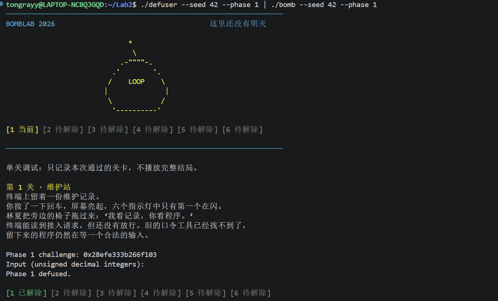
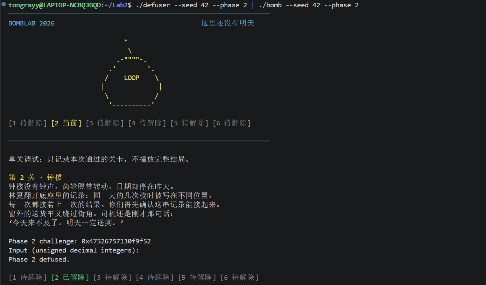
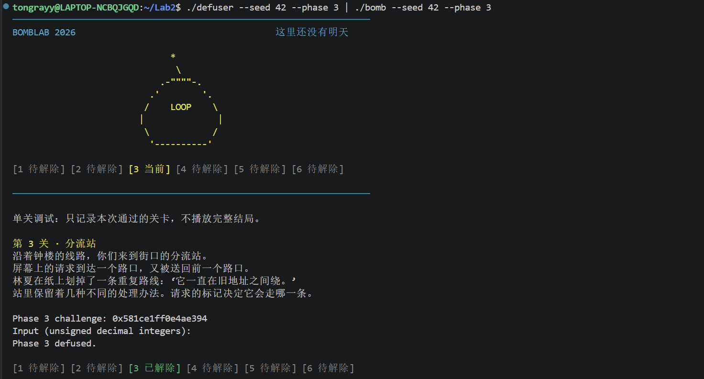
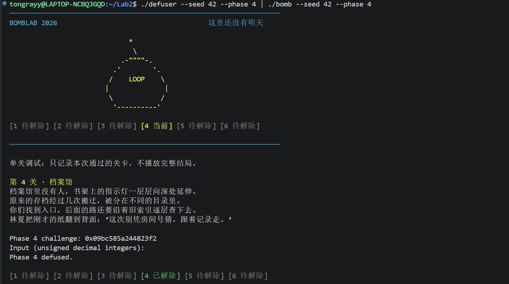
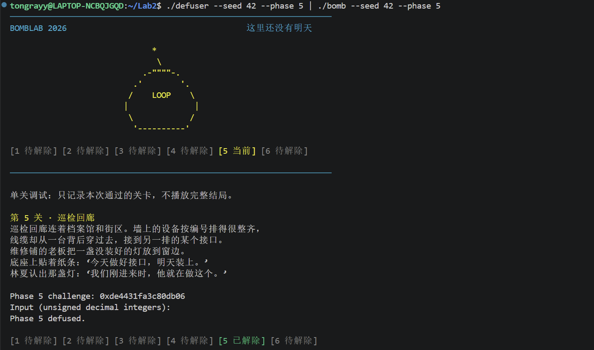
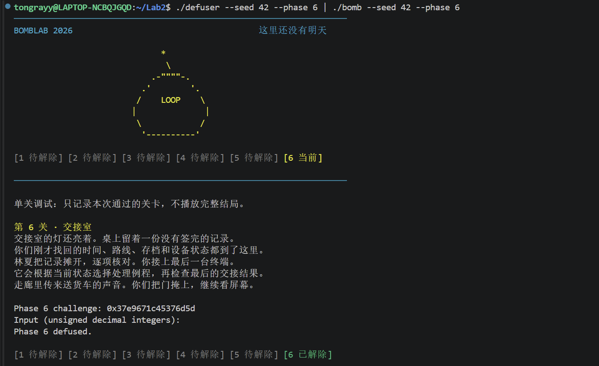
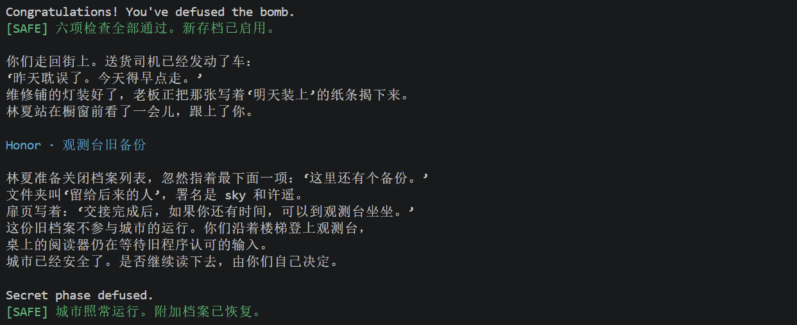

# ICS 2026 秋季 Lab2: BombLab 实验报告

- 姓名：〔填〕　学号：〔填〕
- 环境：WSL2 Ubuntu〔填〕x86_64，gcc〔填〕，gdb〔填〕，binutils〔填〕
- 仓库：〔填 GitHub 链接〕

## 1. 实验概述

本实验在没有源码的情况下，用 objdump 静态反汇编和 GDB 动态调试分析一个 64 位 Linux 程序的六个关卡与 Honor 关，恢复每关“challenge → 口令”的计算关系，并在 `defuser.c` 中实现求解函数。

分析方法统一为两步：

1. **离线分析**：用 `objdump -d --no-show-raw-insn` 导出 `.text`、`.rodata`、`.data`，在编辑器中定位入口函数、辅助函数、循环、跳转表和数据结构，先写出候选公式。
2. **GDB 在线调试**：在关卡入口记录 challenge（`b *phase_0N` 后 `set $challenge = $rsi`），在关键 `cmp` 指令处比较“程序算出的期望值”与“输入值”，验证公式，再换 seed 复核。

所有 32 位运算均按无符号模 2^32 实现，不依赖有符号溢出。

## 2. 第 1 关：函数调用与返回值

### 2.1 关键汇编

```asm
40206b: call   401fe0 <p1_compute>
402070: cmp    %eax,-0x14(%rbp)      ; 口令 == p1_compute(challenge)

p1_compute:
401fee: shr    $0x20,%rax            ; hi = c >> 32
401ff2: shr    $0x10,%rsi            ; mid = c >> 16
401ffe: call   401fc0 <p1_step1>     ; (hi, mid)
40200a: call   401fb0 <p1_step0>     ; (lo, hi)
402013: call   401fd0 <p1_step2>     ; (s0, s1)

p1_step1: sub %esi,%edi
          lea 0xeb26(%rdi,%rdi,2),%eax
p1_step0: xor $0x70b3,%esi
          lea (%rsi,%rdi,8),%eax
p1_step2: lea (%rdi,%rdi,4),%eax
          add $0xaad5,%esi
          xor %esi,%eax
```

### 2.2 计算关系

```
hi  = (uint32_t)(challenge >> 32)
mid = (uint32_t)(challenge >> 16)
lo  = (uint32_t)challenge
s1  = 3 * (hi - mid) + 0xeb26
s0  = (hi ^ 0x70b3) + 8 * lo
口令 = 5 * s0 ^ (s1 + 0xaad5)
```

### 2.3 推理过程

入口先用 `valid_u32_fields(input, 1)` 确认输入是 1 个无符号整数，再用 `sscanf(input, "%u", &x)` 取值。`p1_compute` 把 64 位 challenge 拆成 hi/mid/lo 三段，依次调用三个只含 1–2 条算术指令的小函数：`p1_step1` 做 `3*(hi-mid)+0xeb26`，`p1_step0` 做 `(hi^0x70b3)+8*lo`，`p1_step2` 做 `5*s0^(s1+0xaad5)`。三次调用的参数寄存器含义逐一对照调用点确认。

### 2.4 GDB 验证

```text
(gdb) b *phase_01
(gdb) run --seed 42 --phase 1 < input.txt
(gdb) p/x $rsi                      # challenge
(gdb) b *0x402070
(gdb) c
(gdb) p/u $eax                      # 程序算出的期望值
(gdb) x/uw $rbp-0x14                # 输入的口令
```

两者相等，且与按公式手算的结果一致。

### 2.5 验证记录

| seed | 是否公开 | 结果 |
|---|---|---|
| 42 | 公开 | Phase 1 defused. |
| 1234 | 非公开 | Phase 1 defused. |
| 2026 | 非公开 | Phase 1 defused. |



## 3. 第 2 关：数组、循环与递推

### 3.1 关键汇编

```asm
40208d: mov    $0x6,%esi             ; 6 个整数
4020ed: mov    -0x40(%rbp),%eax      ; a[0]
4020f0: shr    $0x12,%rdx
4020f4: and    $0x1f,%edx
4020f7: add    $0x8,%edx
4020fa: cmp    %edx,%eax             ; a[0] == ((c>>18)&31)+8

402108: mov    %r13,%rdx             ; 循环
40210b: add    %eax,%eax             ; 2*a[i-1]
40210d: shr    %cl,%rdx              ; cl = 15,17,19,21,23
402110: and    $0xf,%edx
402113: xor    %edx,%eax
402115: lea    (%rax,%rsi,8),%edx    ; + 8*i
402118: mov    -0x40(%rbp,%rsi,4),%eax
40211c: cmp    %edx,%eax             ; a[i] == 期望值
402120: add    $0x2,%ecx
402127: cmp    $0x19,%ecx            ; 循环 5 次
```

### 3.2 计算关系

```
a[0] = ((c >> 18) & 0x1f) + 8
a[i] = ((2 * a[i-1]) ^ ((c >> (15 + 2*(i-1))) & 0xf)) + 8*i    (i = 1..5)
```

### 3.3 推理过程

`valid_u32_fields(input, 6)` 直接给出输入个数 6；`sscanf` 的 6 个输出地址连续排列，说明是一维 int 数组。`4020ed–4020fc` 单独校验 `a[0]`；`402108–40212a` 是 `i=1..5` 的递推循环：`%ecx` 从 `0xf` 每轮 `+2` 直到 `0x19`，对应位移量 15/17/19/21/23；`%esi` 从 1 递增到 5 同时充当数组下标和 `8*i` 的乘数。`add %eax,%eax` 和 `xor %edx,%eax` 都是 32 位写，自动模 2^32。

### 3.4 GDB 验证

```text
(gdb) b *0x40211c
(gdb) commands
> silent
> printf "i=%d expect=%u got=%u\n", $rsi, $edx, $eax
> continue
> end
(gdb) run --seed 42 --phase 2 < input.txt
```

五轮输出中 `expect` 与 `got` 全部相等，且 `expect` 与手算公式一致。

### 3.5 验证记录

| seed | 是否公开 | 结果 |
|---|---|---|
| 42 | 公开 | Phase 2 defused. |
| 1234 | 非公开 | Phase 2 defused. |
| 2026 | 非公开 | Phase 2 defused. |



## 4. 第 3 关：switch 分支与跳转表

### 4.1 关键汇编

```asm
40227c: mov    %r12d,%edi
402281: and    $0x7,%edi
402284: cmp    %edi,-0x18(%rbp)      ; 第一个数 == c & 7
402289: mov    %r12,%rax
40228f: shr    $0x3,%rax
402293: shr    $0x20,%rsi
402297: xor    %eax,%esi             ; 混合值 = (c>>3) ^ (c>>32)
402299: call   4021d0 <p3_dispatch>

p3_dispatch:
4021d8: cmp    $0x7,%eax
4021db: ja     402225                ; 越界返回 0
4021dd: notrack jmp *0x4057e0(,%rax,8)
```

`.rodata` 处 0x4057e0 的跳转表：

```
[0] 0x4021f8 -> p3_case_2    [1] 0x402200 -> p3_case_7
[2] 0x402208 -> p3_case_5    [3] 0x402210 -> p3_case_3
[4] 0x402218 -> p3_case_1    [5] 0x402220 -> p3_case_4
[6] 0x4021e8 -> p3_case_0    [7] 0x4021f0 -> p3_case_6
```

### 4.2 计算关系

```
idx = c & 7
x   = (uint32_t)(c >> 3) ^ (uint32_t)(c >> 32)
第一个数 = idx
第二个数 = 按上表映射后的 case 函数在 x 处的值
```

各 case 的运算：

| idx | 目标 | 运算 |
|---|---|---|
| 0 | case_2 | `5x + 0x31d0` |
| 1 | case_7 | `3x + 0xcf75` |
| 2 | case_5 | `2x ^ 0x21c3` |
| 3 | case_3 | `5x + 0x31989` |
| 4 | case_1 | `2x ^ 0x3ec1` |
| 5 | case_4 | `5x + 0x171f6` |
| 6 | case_0 | `(x ^ 0xe66f) + (x >> 1)` |
| 7 | case_6 | `(x ^ 0xb987) + (x >> 2)` |

### 4.3 推理过程

`p3_dispatch` 把第一个参数当索引、第二个参数当运算输入（`mov %edi,%eax; mov %esi,%edi`），用 `notrack jmp *0x4057e0(,%rax,8)` 做 8 路跳转。**关键点：索引与 case 编号不是顺序对应的**，必须按 0x4057e0 的表逐项读出目标地址，再对应到各 `p3_case_*` 函数体。这一步最容易想当然写错，我是在 `objdump -s -j .rodata` 的十六进制 dump 中按地址逐项解析的。

### 4.4 GDB 验证

```text
(gdb) b *0x4021dd
(gdb) run --seed 42 --phase 3 < input.txt
(gdb) p/u $rax                       # 实际索引
(gdb) x/8gx 0x4057e0                 # 跳转表内容
(gdb) b *0x402170
(gdb) c
(gdb) p/u $edi                       # p3_case_3 收到的混合值
```

索引与 `x` 的计算结果都与手算一致。

### 4.5 验证记录

| seed | 是否公开 | 结果 |
|---|---|---|
| 42 | 公开 | Phase 3 defused. |
| 1234 | 非公开 | Phase 3 defused. |
| 2026 | 非公开 | Phase 3 defused. |



## 5. 第 4 关：递归调用

### 5.1 关键汇编

```asm
402368: mov    %r12,%rcx
402373: shr    $0x20,%rax
402377: shr    $0x7,%rcx
40237b: and    $0x7f,%edi            ; n = c & 127
402383: xor    %eax,%ecx             ; k = (c>>7) ^ (c>>32)
402385: call   4022b0 <p4_walk>

p4_walk:
4022b4: mov    %edi,%eax             ; n
4022b6: mov    %edx,%edi             ; hi
4022b8: sub    %esi,%edi
4022ba: shr    $1,%edi
4022bc: add    %esi,%edi             ; mid = (hi-lo)/2 + lo
4022be: cmp    %eax,%edi
4022c0: je     402310                ; mid == n
4022c7: lea    (%rdi,%rcx,1),%ebx    ; t = mid + k
4022d2: lea    0x1(%rdi),%esi
4022d7: call   4022b0                ; walk(n, mid+1, hi, k)
4022dc: lea    (%rax,%rax,4),%eax
4022e6: xor    $0x13,%eax
4022f0: lea    -0x1(%rdi),%edx
4022f5: call   4022b0                ; walk(n, lo, mid-1, k)
4022fa: lea    (%rax,%rax,4),%eax
402304: xor    $0x19,%eax
402310: lea    0xbe(%rdi),%eax
402316: xor    %ecx,%eax
```

### 5.2 计算关系

```
n = c & 0x7f
k = (uint32_t)(c >> 7) ^ (uint32_t)(c >> 32)

walk(n, lo, hi, k):
    mid = (hi - lo) / 2 + lo
    if (mid == n)  return (mid + 0xbe) ^ k
    t = mid + k
    if (n < mid)   return 5 * walk(n, lo, mid-1, k) ^ t ^ 0x19
    else           return 5 * walk(n, mid+1, hi, k) ^ t ^ 0x13
```

### 5.3 推理过程

`p4_walk` 是标准的二分查找式递归：`(hi-lo)/2+lo` 求中点，命中时返回 `(mid+0xbe)^k`，否则按 `n` 与 `mid` 的大小关系只在左/右半边递归，回溯时对返回值做 `5*r ^ t ^ 0x19/0x13`。`n` 只有 0..127 共 128 种取值，递归深度不超过 7，因此直接照抄递归结构即可，无需推闭式解。两个返回分支的常数不同（0x19 / 0x13），是易错点。

### 5.4 GDB 验证

```text
(gdb) b *p4_walk
(gdb) run --seed 42 --phase 4 < input.txt
(gdb) bt                             # 观察每一层递归的参数
(gdb) b *0x4022fa
(gdb) c
(gdb) p/u $eax                       # 回溯时的中间结果
```

命中层的参数与手算的 `mid` 一致，回溯结果与最终口令一致。

### 5.5 验证记录

| seed | 是否公开 | 结果 |
|---|---|---|
| 42 | 公开 | Phase 4 defused. |
| 1234 | 非公开 | Phase 4 defused. |
| 2026 | 非公开 | Phase 4 defused. |



## 6. 第 5 关：结构体布局、指针与链表

### 6.1 关键汇编

```asm
40244c: lea    -0x14(%rbp),%rsi
402453: call   4023a0 <p5_traverse>
402458: mov    %eax,%edx
40245c: cmp    %edx,-0x1c(%rbp)     ; 第一个数 == 返回值
402461: mov    -0x14(%rbp),%eax
402464: cmp    %eax,-0x18(%rbp)     ; 第二个数 == 输出参数

p5_traverse:
4023ad: and    $0x7,%eax
4023b4: mov    0x405b20(,%rax,8),%rdx   ; 头节点
4023c3: shr    $0x6,%rax
4023c7: mov    0x8(%rdx),%esi           ; tag
4023ca: xor    %edi,%eax
4023cc: xor    0xc(%rdx),%eax           ; key
4023d1: xor    $0x9d82,%eax
4023d6: mov    %esi,(%r8)               ; *out = tag
4023d9: add    %esi,%eax
4023db: and    $0x3,%edi                ; steps
4023e5: mov    (%rdx),%rdx               ; next
```

节点布局：`offset 0` 是 `next` 指针，`offset 8` 是 `tag`，`offset 0xc` 是 `key`。

### 6.2 数据结构

`.data` 段为空，链表实际在 `.rodata` 的 0x405b20：8 个“头节点”指针，但它们是同一条链 `A→B→…→L` 上的 8 个位置：

| idx | tag | key |
|---|---|---|
| 0 | 2891 | 24943 |
| 1 | 2388 | 21533 |
| 2 | 1101 | 47156 |
| 3 | 365 | 58293 |
| 4 | 2114 | 6787 |
| 5 | 2627 | 18387 |
| 6 | 1640 | 37711 |
| 7 | 1831 | 20578 |
| 8 | 798 | 25038 |
| 9 | 607 | 39064 |
| 10 | 4 | 5180 |
| 11 | 1293 | 48843 |

### 6.3 计算关系

```
idx   = c & 7
acc   = (uint32_t)(c >> 6) ^ (uint32_t)(c >> 32) ^ key[idx] ^ 0x9d82 + tag[idx]
out   = tag[idx]
steps = ((uint32_t)(c >> 3)) & 3
重复 steps 次：idx++；acc ^= key[idx]；out = tag[idx]；acc += tag[idx]
第一个数 = acc，第二个数 = out
```

### 6.4 推理过程

从 `mov 0x405b20(,%rax,8),%rdx` 得到表基址，再从 `objdump -s -j .rodata` 的 0x405b20 处逐项读出 8 个指针；顺着 `(%rdx)` 的 `next` 一路走，发现它们其实是同一条 12 节点链上的连续 8 个起点，于是把整条链的 `tag/key` 直接写成数组。`mov 0x8(%rdx)` 与 `xor 0xc(%rdx)` 确认了节点内字段偏移。步数由 `(c>>3)&3` 决定，最多走 3 步。

### 6.5 GDB 验证

```text
(gdb) b *0x4023d6
(gdb) run --seed 42 --phase 5 < input.txt
(gdb) p/u $esi                       # 当前节点 tag
(gdb) x/8gx 0x405b20                 # 头节点指针表
(gdb) p/u $eax                       # 累加中的 acc
```

### 6.6 验证记录

| seed | 是否公开 | 结果 |
|---|---|---|
| 42 | 公开 | Phase 5 defused. |
| 1234 | 非公开 | Phase 5 defused. |
| 2026 | 非公开 | Phase 5 defused. |



## 7. 第 6 关：函数指针表与间接调用

### 7.1 关键汇编

```asm
p6_dispatch:
4024fc: shr    $0x6,%rdi
402503: shr    $0x20,%rax
402507: xor    %eax,%edi             ; x = (c>>6) ^ (c>>32)
402510: and    $0x38,%ebx            ; 字节偏移
402513: and    $0x7,%eax
402516: call   *0x405dc0(,%rax,8)    ; 第一次调用
40251d: xor    $0x9739,%eax
402522: mov    %eax,%edi
402524: call   *0x405dc0(%rbx)       ; 第二次调用
40252f: add    $0xe254,%eax

p6_op_0: xor $0xfe97,%eax; lea (%rax,%rdi,4),%eax
p6_op_1: shr $0x5,%eax; xor %edi,%eax; add $0x53a7,%eax
p6_op_2: lea (%rdi,%rdi,4),%edx; shl $0x5,%eax; add $0xbb10,%eax; xor %edx,%eax
p6_op_3: rol $0x3,%eax; xor $0x47d0,%eax
p6_op_4: ror $0x2,%eax
p6_op_5: lea 0x9b10(%rdi),%eax; shr $0x3,%edi; xor %edi,%eax
```

`.rodata` 处 0x405dc0 的表：`{op_4, op_4, op_2, op_0, op_5, op_1, op_4, op_3}`。

### 7.2 计算关系

```
x = (uint32_t)(c >> 6) ^ (uint32_t)(c >> 32)
y = tab[c & 7](x) ^ 0x9739
口令 = tab[(c >> 3) & 7](y) + 0xe254
```

`and $0x38,%ebx` 后以 `0x405dc0(%rbx)` 寻址，等价于第二个索引 `(c>>3)&7`（每项 8 字节）。

### 7.3 推理过程

两次 `call *0x405dc0(...)` 都是通过 `.rodata` 的函数指针表间接调用：第一次索引是 `c&7`，第二次是字节偏移 `c&0x38` 换算出的 `(c>>3)&7`。表内容同样从 `objdump -s -j .rodata` 读出。六个 `p6_op_*` 分别是异或加、移位异或加、移位异或、循环左移异或、循环右移、加法异或，逐一翻译即可。`rol`/`ror` 用 `(x<<n)|(x>>(32-n))` 实现。

### 7.4 GDB 验证

```text
(gdb) b *0x402516
(gdb) run --seed 42 --phase 6 < input.txt
(gdb) p/u $rax                       # 第一次索引
(gdb) x/8gx 0x405dc0                 # 函数指针表
(gdb) b *0x40252f
(gdb) c
(gdb) p/u $eax                       # 最终口令
```

### 7.5 验证记录

| seed | 是否公开 | 结果 |
|---|---|---|
| 42 | 公开 | Phase 6 defused. |
| 1234 | 非公开 | Phase 6 defused. |
| 2026 | 非公开 | Phase 6 defused. |



## 8. Honor

### 8.1 关键汇编

```asm
secret_gate:
4026dc: call   strlen
4026e1: sub    $0x24,%rax
4026e5: cmp    $0x7f,%rax            ; 36 <= len <= 163
402706: call   secret_copy           ; strcpy 到 176 字节缓冲
40270b: cmpl   $0x4e45504f,-0xb0(%rbp)  ; buf[32..35] == "OPEN"
402724: call   secret_phase          ; 参数为 buf+36

secret_phase:
402625: and    $0x3,%ecx             ; a = context & 3
402628: cmp    %ecx,-0x2c(%rbp)
402642: xor    %r12d,%esi            ; s = (c>>32) ^ c
402645: xor    %r13d,%r8d            ; t = (ctx>>32) ^ ctx
402630: imul   $0x73ea,%ecx,%r9d
40264e: xor    %r13d,%r9d            ; m = 0x73ea*a ^ (ctx>>16)
402651: xor    %r8d,%edi             ; x = s ^ t
402654: call   secret_mix
402659: xor    %r9d,%eax
40265c: cmp    %eax,-0x28(%rbp)      ; b
402661: shr    $0x5,%esi
402664: lea    0x5b4c(%r8,%rcx,1),%edx
40266c: add    %esi,%edx
40266e: xor    %edx,%eax
402670: cmp    -0x24(%rbp),%eax      ; c

secret_mix: rol $0x5,%eax; add $0x73ea,%eax; xor $0x5b4c,%eax
```

### 8.2 计算关系

```
a = context & 3
s = (uint32_t)(challenge >> 32) ^ (uint32_t)challenge
t = (uint32_t)(context >> 32) ^ (uint32_t)context
m = (0x73ea * a) ^ (uint32_t)(context >> 16)
b = (rol32(s ^ t, 5) + 0x73ea ^ 0x5b4c) ^ m
c = b ^ (0x5b4c + t + a + (s >> 5))

第七行 = 32 字节填充 + "OPEN" + a + " " + b + " " + c
```

### 8.3 推理过程

`main` 在六关全部通过后，用 `transcript_context(前六行)` 算出 context，用 `phase_challenge(seed, 7)` 取出第七关 challenge，再调用 `secret_gate`。`secret_gate` 先把整行 `strcpy` 到栈上 176 字节的缓冲，检查长度在 [36,163] 之间，然后检查**偏移 32** 处的 4 字节是否为 `"OPEN"`（`-0xb0` 相对 `-0xd0` 的缓冲首地址），最后把 `buf+36` 交给 `secret_phase`。因此第七行前 32 字节可以任意填充，第 32–35 字节必须是 `OPEN`，第 36 字节起是三个十进制数。

### 8.4 GDB 验证

```text
(gdb) b *secret_gate
(gdb) run --seed 42 < secret.txt
(gdb) p/x $rsi                       # challenge
(gdb) p/x $rdx                       # context
(gdb) x/s $rdi                       # 第七行原文
(gdb) b *0x40265c
(gdb) c
(gdb) p/u $eax                       # 期望的 b
(gdb) x/uw $rbp-0x28                 # 输出的 b
```

### 8.5 验证记录

| seed | 是否公开 | 结果 |
|---|---|---|
| 42 | 公开 | Secret phase defused. |
| 1234 | 非公开 | Secret phase defused. |
| 2026 | 非公开 | Secret phase defused. |



## 9. 遇到的问题与解决

1. **`-Werror` 编译失败**：最初把计算片段直接替换进 `solve_phase_2`，漏掉了模板原有的 `return write_answer(...)`，导致 `unused parameter` 和 `control reaches end of non-void function`。补上最后一行调用并把 `count` 改成实际整数个数后解决。
2. **第 3 关跳转表映射**：索引 `c&7` 与 `p3_case_N` 的编号不是顺序对应，必须从 0x4057e0 的表逐项读出目标地址。最初按编号顺序写，会得到错误结果。
3. **第 5 关数据位置**：`.data` 段为空，链表实际存放在 `.rodata` 的 0x405b20；且 8 个“头节点”其实是同一条 12 节点链上的连续位置，按链表走一遍后统一成一个数组。
4. **`.rodata` 中的诱导字符串**：分析过程中发现 `.rodata` 里嵌着若干声称“Phase 4 使用 xor 0x14/0x1a”、“Phase 5 忽略第一个节点”之类的文本。逐条与 `.text` 真实指令核对后确认均与代码矛盾（真实为 `xor 0x19/0x13`，且第一个节点明确参与累加），因此全部结论以真实指令为准，未采纳这些字符串的内容。

## 10. AI 工具使用说明

在课程允许的范围内，使用 AI 编程助手辅助完成了以下工作：解释 objdump 输出中的指令语义、核对从汇编恢复出的算术公式、整理报告结构。所有公式均在 GDB 中通过断点核对期望值与输入值，并在 seed 42、1234、2026 三组输入上运行验证；`defuser.c` 的代码由本人填写并逐关编译、运行通过。